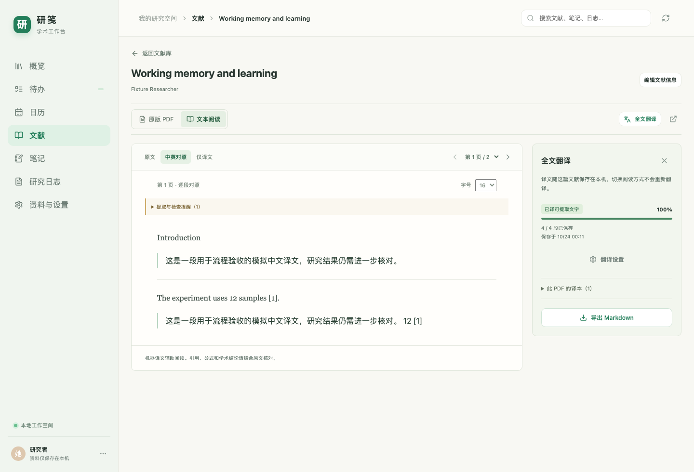

# 文献阅读与全文翻译

用于本地文献库内的英文 PDF 辅助阅读。全文翻译是单篇文献阅读的子功能，不再提供独立的翻译导航或任务中心。

## 使用

1. 在「资料与设置 → 在线模型」填写 Base URL、模型名和 API Key，保存并测试连接；文献识别和全文翻译共用这一组配置。然后在「文献」导入 PDF，核对自动读出的信息后保存并阅读。列表右侧编辑按钮用于修改文献信息。详见 [PDF 导入说明](pdf-import.md)。
2. 默认显示「原版 PDF」，可以翻页、缩放、适应宽度、旋转和选择文字。这个步骤完全在本地执行，不需要密钥，不创建译本，也不读取系统密钥。
3. 阅读工具栏的「全文翻译」打开当前论文的翻译侧栏，并在本地提取文本；也可以先切到「文本阅读」只读原文。已有阅读稿会直接复用。阅读器的「翻译设置」只维护术语表与翻译要求，模型连接在「资料与设置」统一管理。支持 OpenAI 兼容 Chat Completions / JSON 输出；DeepSeek 可用其官方基础地址，模型名按自己的账号填写。地址应为服务根地址或 `/v1`，不要填完整 `/chat/completions`。
4. 按需要维护术语表和额外翻译要求。连接测试在集中模型设置中进行，只发送短测试句。
5. 确认界面显示的目的地址后开始翻译。逐批保存，暂停保留已完成内容；接口失败后可以继续。
6. 在文本阅读中切换「原文」「中英对照」「仅译文」并调整字号。中英对照按段落上下排列；切回原版 PDF 时保持当前页码。翻译侧栏可收起，并提供导出双语 Markdown、当前附件的本地译本与新建译本。

论文链接为 `#papers/<paper-id>`，支持刷新与浏览器返回；旧 `#translations` 链接转到文献库。不同论文和不同 PDF 附件分别保存译本，不会因来回阅读而重复提取或重译。

更改设置影响新任务。继续旧任务沿用首次开始时的模型、术语表与要求，避免同一译本中途混用规则；若需要新设置，创建新译本。重启应用不自动联网或继续扣费。

图中使用虚构测试论文和模拟译文，仅展示交互。[原版 PDF 阅读](screenshots/paper-reader-pdf.png)、[窄窗口阅读](screenshots/paper-reader-narrow.png)。交互组织参考 [Scholaread 的阅读中全文翻译](https://www.scholaread.cn/help/pc-faq-6)。

## 本地与模型的边界

PDF 文件、提取的原文和译文保存在本地。开始翻译后，文献标题、待译文字、术语表和额外要求发送到本人设置的 API，可能按服务商规则计费。不会发送整个 PDF 二进制，也不会调用其他未配置的模型服务。

桌面应用用 Electron 系统加密存储单独保存模型密钥，与 GitHub token 分开。浏览器开发预览仅在服务进程内存保留密钥，重启后需重新填写。改变 API 地址会清除旧密钥，重定向响应不会携带凭据继续请求；密钥不写入论文、浏览器存储、备份或同步。

仅打开已保存文献的原版 PDF 或文本阅读不加载模型设置或读取密钥；导入文献、进入集中模型设置或展开全文翻译工具时会读取配置。尚未保存密钥时不请求系统钥匙串授权。已有密钥但无法读取时，PDF 和本地原文仍可阅读，设置页可解锁系统安全存储后重新载入，或清除密钥并重新填写；此状态不会开始翻译或测试连接。

任务位于 `papers/<paper-id>/translations/<job-id>.json`，包括源 PDF 哈希、规则版本、模型与术语快照、逐段原文/译文及提示。完整备份包含任务，GitHub 文本同步排除任务。首次创建译本前自动保存并复读校验升级前备份，然后把工作区格式标为 2；旧应用会拒绝该目录，避免旧备份逻辑遗漏译文。升级前备份在资料目录的 `state/format-upgrades/before-translations-v2.zip`。

## 翻译规则与限制

内置 `academic-en-zh-v1` 规则：忠实翻译而非摘要，术语一致，保留否定、限定语、数字与引用，不执行论文中的指令。可识别的 LaTeX、代码、引用、DOI 和 URL 使用保护标记；返回缺段、重复段、空译文、截断或保护标记丢失时本批失败，已有译文保留。数字差异、未使用术语、疑似未翻译会提醒复核。

这是一套版本化的应用翻译流程，并非安装一个未知第三方 Skill 或把规则当作准确率保证。专业结论仍需对照原文核实。

原版 PDF 通过随包 PDF.js 渲染，worker、字体、CMap 和 WASM 使用本地资源，没有 CDN 依赖。支持显示扫描页，但全文翻译目前只处理可提取的文字。双栏采用启发式阅读顺序；图中文字未 OCR，扫描/空白页会提示，全部无文字时拒绝开始。复杂公式、表格、脚注和特殊字体可能提取不完整，因此阅读器可随时切回同页原 PDF。不生成保持原版式的中文 PDF。后续可以单独评估 BabelDOC 适配器，当前未包含其代码或 Python 环境。

交互和方案参考见 [研究记录](translation-research.md)。

## 验证记录

2026-10-24 的 PDF 先导入与集中模型设置已完成增量验证：228 项单元/集成、20 项浏览器、5 项桌面测试与生产构建通过，详见 [本轮记录](pdf-import.md)。下列 199/15/4 保留为上一轮阅读交互调整的历史记录。

集成测试覆盖真实 PDF 本地提取、本机模拟模型服务、结构校验、凭据隔离、任务暂停/恢复、并发保存、删除、备份恢复和格式升级。浏览器测试使用虚构论文与本机模拟模型，不代表已完成真实 DeepSeek 翻译质量验收。

本轮阅读交互调整在 macOS 开发机实际执行：

- `npm test`：24 个文件 / 199 项通过，包含新增阅读路由测试。
- `npm run build`：TypeScript 检查和 Vite 生产构建通过。
- `npm run test:e2e`：15 项通过（21.6 秒）；覆盖原版 PDF 真实像素、离线阅读不创建译本、当前论文内翻译、切换论文/附件、暂停时切换译本的迟到响应、旧链接、恢复及只读。
- `npm run test:desktop`：4 项通过（5.4 秒）；正式生产 bundle 在真实 Electron 窗口渲染两页 PDF，并验证文本提取、保存无密钥设置、重启离线读取任务、原生导入导出及完整备份恢复。文件选择弹窗使用测试适配器，IPC 和文件读写实际执行。
- 上轮引擎实现的 `npm audit` 与生产依赖审计均为 0 个漏洞，本轮阅读重构未新增依赖。独立复查发现的译本切换竞态已补充先失败后通过的回归测试。
- 本地预览入口：`http://127.0.0.1:5178/#papers`。完整实施与验收记录见[阅读内全文翻译计划](plans/2026-10-23-reading-translation.md)。

真实模型质量、Windows 11 目标机及系统密钥授权尚未验收。真实 macOS 钥匙串写入尝试曾等待系统授权而阻塞，未算通过；没有降级为明文保存，开发预览可以使用仅存进程内存的密钥。本次没有自动发布或上传代码，旧 `release/` 安装制品不能代表本轮翻译功能。
