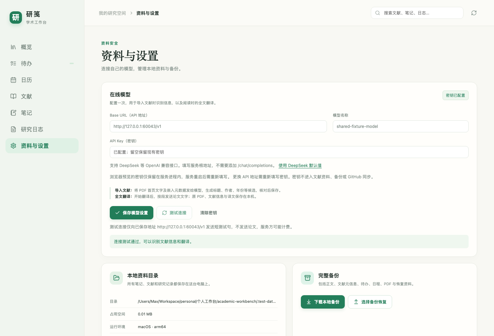
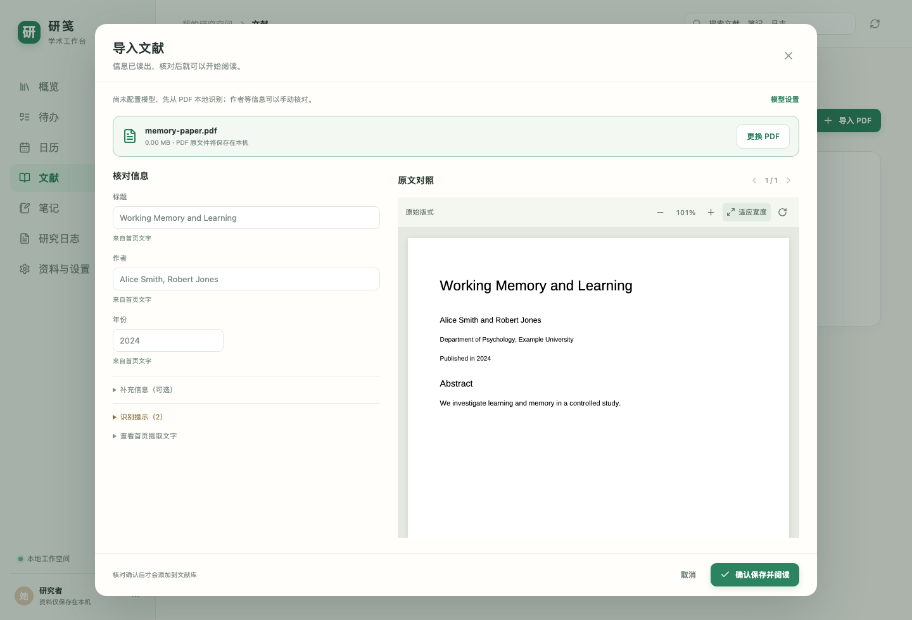

# PDF 导入与共享模型

在「资料与设置 → 在线模型」填写 Base URL、模型名称和 API Key，保存后可测试连接。支持 DeepSeek 等 OpenAI 兼容接口；基础地址不要加 `/chat/completions`。这一组配置同时用于文献识别和全文翻译。

## 添加文献

1. 打开「文献 → 导入 PDF」，或概览的「添加文献」，选择或拖入一份 PDF（最大 50 MB）。无需先填写文献信息。
2. 已配置模型时，导入界面会显示模型和地址；选入文件后，将本地提取的首页文字及内嵌候选发给该模型识别。没有密钥、模型失败或配置不可读取时，仍可使用本地识别并核对。
3. 默认核对标题、作者和年份，右侧是原版 PDF；期刊、DOI、链接在「补充信息」中。识别来源会标注，无把握的信息留空；可展开首页提取文字或识别提示。
4. 点击「确认保存并阅读」，文献信息和 PDF 一起保存到本地，进入阅读器。取消不会创建文献；更换文件会废弃上一份文件的识别结果。保存响应丢失时保留输入，重试不会重复创建。
5. 阅读时打开「全文翻译」，确认发送地址后开始；无需再填写一份 API Key。术语表和额外翻译要求仍在阅读器的「翻译设置」中维护。

截图使用虚构论文和本机模拟模型。另见[窄窗口核对](screenshots/pdf-import-review-narrow.png)。没有 PDF 时可使用文献库「手动录入」；旧文献的编辑与追加附件功能保留。

## 边界

这里识别的是 PDF 中的信息，不是联网检索出版商数据库。模型的字段需要原文依据并接受格式校验，但仍需本人核对。扫描件没有 OCR 时可用文件名作为标题，作者、年份留空，保存后继续阅读原 PDF。不会将 PDF 制作工具或文件创建时间当作作者或发表年份。

原 PDF 不发送给在线模型：识别发送首页文字和内嵌候选，翻译按段发送文字。密钥使用既有安全存储：桌面系统加密，浏览器预览仅保留于服务进程内存；不回显、不进入论文资料、备份或 GitHub。更换 API 地址需重新填写密钥。

确认保存前没有可见文献。确认时校验资料目录身份、写锁和 PDF；先写临时目录、校验后原子发布。稳定的请求编号用于重试去重，恢复或切换资料目录不能将旧请求写入新的目录。

## 2026-10-24 验证

macOS 开发机实际执行：

- `npm test`：28 个文件、228 项通过；包括真实 PDF 解析、模型结构/依据、认证、取消、文件限制、幂等、并发、失败回滚、只读、写锁失效、重启与完整备份恢复。
- `npm run build`：TypeScript 与 Vite 生产构建通过。
- `npm run test:e2e`：20 项通过（28.2 秒）；覆盖 PDF 先导入、核对、取消、损坏文件、扫描页、迟到响应、更换文件、未知保存结果重试，以及一套集中模型配置用于识别和全文翻译。既有阅读、资料管理、只读、备份恢复、同步交互通过回归。
- `npm run test:desktop`：5 项通过（55.6 秒）；真实 Electron 生产窗口验证 PDF 先导入、自动元信息、保存阅读、重启持久化，以及既有原生文件操作和完整备份恢复。系统选择对话框由测试适配器控制，IPC 和文件读写真正执行。
- 桌面和 390 像素窄窗口截图已检查；浏览器模型闭环无页面错误，密钥不回显。
- 已核实并重启仅本应用的预览服务，`http://127.0.0.1:5178/#settings` 返回可用界面；实际走过文献库 → 导入 PDF → 模型设置，未向真实预览资料写入测试文献。

未使用真实 DeepSeek 密钥或私人论文，未验收真实模型识别/翻译质量；Windows 11 实机、系统密钥授权仍待验收。没有发布或上传代码。本轮未增加依赖。
